# Year1

**DJ & YW · 1st Anniversary**

Experience the world together.

一块一块，拼出我们。然后一起散步、跳舞、抱抱，把平常的一天过成小小的纪念。

A little world for our first year together. Build us, bring us to life, and stay for a little dance.

**[走进我们的小世界 · Enter our little world ↗](https://hudsonrivercrossing.github.io/Year1/)**

  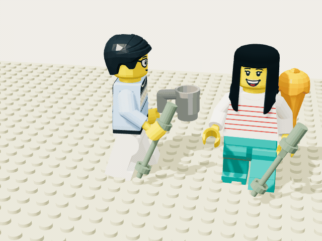

  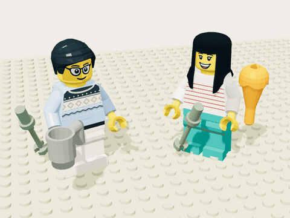
  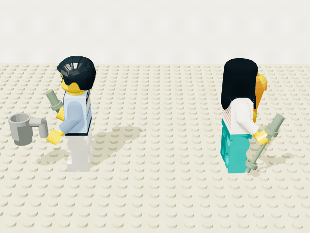

## 从一份礼物开始

最初是一幅装着两个人仔的纪念相框。现在，相框里的我们有了一个可以一起走走的小世界。

  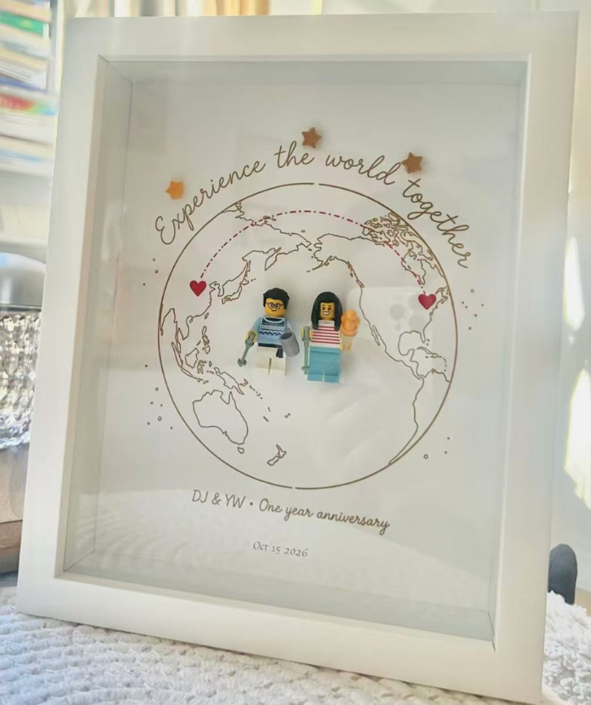

## 一起玩

把散落的零件拼成 DJ 和 YW，或点「我太懒了」帮忙拼好。唤醒之后，陪他们漫步、牵手、亲脸颊，或跳一支舞。

想更有气氛，就打开右上角的音乐。

## 两个人，十二块积木

<table align="center">
  <tr><th align="center">DJ</th><th align="center">YW</th></tr>
  <tr>
    <td align="center">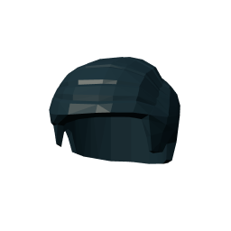 侧梳短发 <code>99930</code></td>
    <td align="center">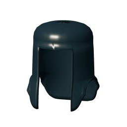 平刘海长直发 原创近似 · 参考 17346 / 75867</td>
  </tr>
  <tr>
    <td align="center"> 圆框眼镜笑脸 <code>3626cp8y</code> 目录 3626pb1507</td>
    <td align="center"> 笑脸对照款 <code>3626cp8r</code> 目录 3626pb1352 家族</td>
  </tr>
  <tr>
    <td align="center">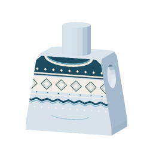 蓝色 Fair Isle 毛衣 <code>973</code> 图案参考 973pb5102c01</td>
    <td align="center">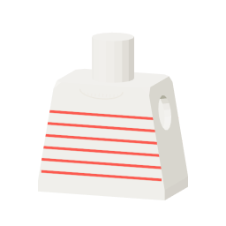 白底红条纹上衣 <code>973</code> 图案参考 973pb3541c01</td>
  </tr>
  <tr>
    <td align="center"> 右臂与夹手 <code>3818 + 3820</code></td>
    <td align="center">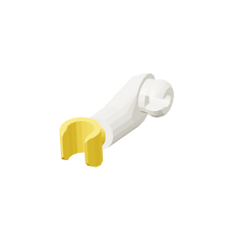 右臂与夹手 <code>3818 + 3820</code></td>
  </tr>
  <tr>
    <td align="center"> 左臂与夹手 <code>3819 + 3820</code></td>
    <td align="center"> 左臂与夹手 <code>3819 + 3820</code></td>
  </tr>
  <tr>
    <td align="center"> 白色髋部与双腿 <code>3815 · 3816 · 3817</code></td>
    <td align="center">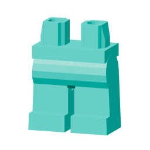 青绿色髋部与双腿 <code>3815 · 3816 · 3817</code></td>
  </tr>
</table>

### 随身的小东西

<table align="center">
  <tr>
    <td align="center">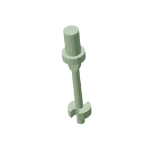 两人右手 · 滑雪杖 <code>90540</code></td>
    <td align="center">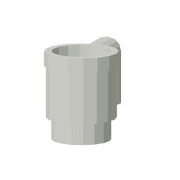 DJ 左手 · 灰杯 <code>3899</code></td>
  </tr>
  <tr>
    <td align="center" colspan="2"> YW 左手 · 橙色甜筒 <code>33120</code></td>
  </tr>
</table>

### 小小生活里的道具

加一会儿班的桌椅电脑、种花的小花苗，还有 DJ 送给 YW 的包。

<table align="center">
  <tr>
    <td align="center">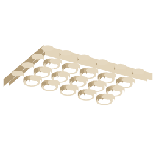 桌面 <code>3032</code> 4 × 6 板</td>
    <td align="center"> 桌腿／椅座支撑 <code>3005</code> 1 × 1 砖</td>
  </tr>
  <tr>
    <td align="center">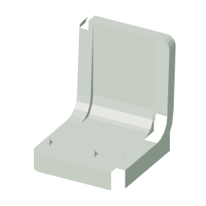 座椅 <code>4079</code> 人仔座椅</td>
    <td align="center">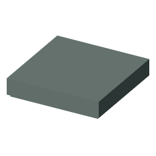 电脑底座、翻盖／花底座 <code>3068b</code> 2 × 2 光面板</td>
  </tr>
  <tr>
    <td align="center">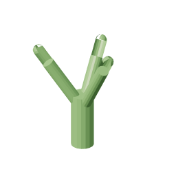 花茎 <code>99249</code> 花茎连接件</td>
    <td align="center">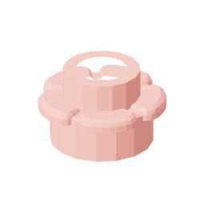 花瓣／手持花苗 <code>24866</code> 五瓣花</td>
  </tr>
  <tr>
    <td align="center" colspan="2">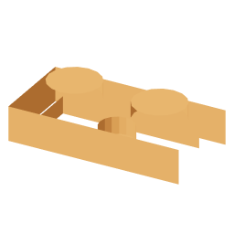 包体基础 <code>3023</code> 1 × 2 板</td>
  </tr>
</table>
